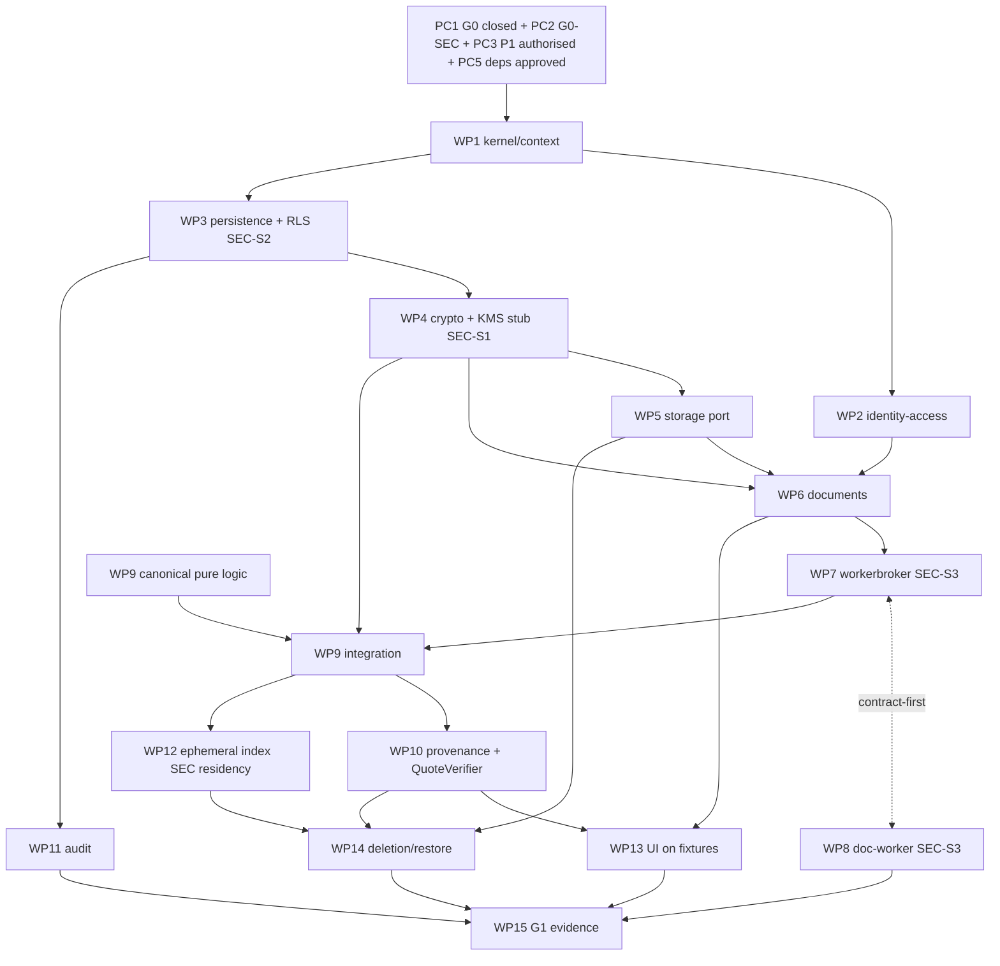

# P1 readiness — evidence core: implementation plan (PLANNING ONLY)

- **Prepared:** 2026-11-20 on branch `prep/p1-readiness`. **P1 is NOT AUTHORISED** (D-21). This document contains
  no implementation. It proposes how P1 would be decomposed **after** P1 has its own recorded authorisation.
- **Status vocabulary:**
  - *Specified*: in the approved v0.2.1 documents.
  - *Proposed*: a suggestion made here.
  - *Owner decision* / *SEC decision* / *LEGAL decision*: reserved to that holder.
- **Inputs:** IMPLEMENTATION_ROADMAP P1; ARCHITECTURE_OVERVIEW; SYSTEM_DESIGN sections 1–5, 11–13;
  SECURITY_AND_PRIVACY; ADRs 0001–0008; the P0 code (`core-api`, module placeholders, `architecture-tests`);
  `docs/g0/G0-SEC_HANDOVER.md`.

## 0. Preconditions (all must hold before any P1 work package starts)

| # | Precondition | Holder | Status (2026-11-20) |
|---|---|---|---|
| PC1 | G0 closed: the remaining version confirmations (G0-1 rest), G0-2 path, G0-3 recorded | Owner | Spring Boot line decided (D-30); the rest **open** |
| PC2 | G0-SEC findings recorded and addressed or consciously accepted, per design S1–S3 | SEC + Owner | **Not started** |
| PC3 | P1 authorisation recorded in DECISION_LOG (scope, any limits) | Owner | **Not given** |
| PC4 | Latest stable Spring Boot 4.2.x patch evaluated (D-30) | Engineering → Owner | Pending |
| PC5 | New production dependencies approved: ICU4J (segmenter), the worker's PDF rendering/text library, Flyway, a crypto library (Tink or JCA), an S3 client, an OIDC client | Owner (+ LEGAL for licences) | **Not requested yet** (section 2.3) |

The roadmap requires G0-SEC **before P1**, not merely before the security work packages. Splitting P1 so that
non-security packages start earlier would be an **owner decision**. It is not assumed here.

---

## 1. Work-package decomposition

Each package is independently reviewable (its own branch and PR). "SEC" marks packages implementing a G0-SEC
design (S1 keys, S2 tenancy/RLS, S3 worker).

### WP1 — Platform kernel: request context, errors, logging hygiene
- **Objective:** the cross-cutting base every module needs: an immutable `TenantContext` type, a request id, RFC
  9457 problem responses with `traceId`, a structured-logging policy with a content scrubber, and a configuration
  convention.
- **Architectural responsibility:** SECURITY section 6.1 (an explicit context parameter, no ambient lookups);
  section 2, T10 (no content in logs).
- **Modules:** a home for `TenantContext` is **undecided**; see section 3.3 (O-6: a new kernel module needs an
  owner-approved ADR). Also `platform/app` (error handling, logging config).
- **Dependencies:** PC1–PC3.
- **Interfaces:** `TenantContext{userId, requestId, scopes}`; a helper that runs async work only with an explicit
  context.
- **Data flow:** none persisted. The context is created only by the security filter (WP2) or the job runner
  (WP7).
- **Security:** the S2 foundation (SEC); log scrubbing (T10).
- **Tests:** ArchUnit (no thread-local or static context access in domain packages; the context type is
  immutable); scrubber canary tests; problem responses never contain content.
- **Acceptance:** every service entry point requires a context (ArchUnit); scrubber tests are green.
- **Risks:** context type placement causing module cycles; over-broad context.
- **Decisions:** the module placement (Owner, ADR). The context design itself is S2 review.

### WP2 — identity-access: OIDC against the dev IdP
- **Objective:** authenticate with OIDC (the Keycloak dev realm), map the subject to an internal `user_id`, issue
  `TenantContext`, provide roles USER/REVIEWER/ADMIN (ADMIN without content access), and record consent.
- **Modules:** `platform/identity-access`, `platform/app` (security filter chain).
- **Dependencies:** WP1; the WP3 schema for the user table.
- **Interfaces:** an internal `CurrentTenant` resolver; no passwords stored (ARCH section 5).
- **Security:** T1, T9, T13. The production IdP is undecided (Owner + SEC; TECHNOLOGY_DECISIONS #13).
- **Tests:** login flows against the dev realm (integration); token validation (issuer, audience, expiry, alg);
  unauthenticated requests get 401; CSRF/CORS configuration tests.
- **Acceptance:** no endpoint is reachable without authentication except health; the context is derived only
  from a validated token.
- **Risks:** Keycloak-specific claims leaking into code. Keep it IdP-agnostic.
- **Decisions:** the production IdP and MFA policy (Owner + SEC). New dependency: Spring Security's OAuth2
  resource-server support (managed by Boot; still a production dependency to approve, PC5).

### WP3 — Persistence foundation: schema, roles, RLS framework (SEC S2)
- **Objective:** Flyway migrations run by an owner role; a non-owner, non-BYPASSRLS application role; FORCE RLS
  on every user table; a transaction wrapper that sets `app.user_id` transaction-locally and refuses to open a
  transaction without context; the `system_scheduler` role and view; a schema lint.
- **Modules:** `db/migrations`; a persistence support package (placement per O-6); every module owning tables.
- **Dependencies:** WP1; PC2 (S2 sign-off).
- **Security:** T1, T19, T20 (SECURITY section 6). Plaintext versus encrypted column classification per
  SYSTEM_DESIGN section 11.
- **Tests:** the two-user isolation matrix over every table; a pool-leak test (connection returned with an empty
  setting); startup refuses superuser/BYPASSRLS; the lint fails on a `user_id` table without policies.
- **Acceptance:** SECURITY section 6.2 tests green in CI against real PostgreSQL (Testcontainers or the Compose
  service).
- **Risks:** a missed table; ORM features that bypass the wrapper; a migration role used at runtime.
- **Decisions:** the S2 review outcome (SEC); PgBouncer usage (Ops/SEC); data access style, JDBC versus JPA
  (Engineering ADR).

### WP4 — crypto: key hierarchy with a dev-local KMS stub (SEC S1)
- **Objective:** implement SECURITY section 3: a Root KEK behind a `KeyEncryptionService` port (a **dev-local
  stub** only), per-user UMKs (wrapped), per-object DEKs, HKDF field and blind-index keys, AES-256-GCM with AAD
  binding, rotation, crypto-shredding and the deletion ledger.
- **Modules:** `platform/crypto`.
- **Dependencies:** WP1, WP3 (`user_key`, `object_key`, `key_event`, `deletion_ledger`); PC2 (S1); PC5 (crypto
  library).
- **Interfaces:** an encrypt/decrypt API for blobs and fields with purpose-bound AAD; a blind-index API; no raw
  key material outside the module (ArchUnit).
- **Security:** T3, T11, T18, T21. **No custom cryptography.**
- **Tests:** round trip; AAD mismatch, wrong key and wrong user rejected; nonce uniqueness under concurrency;
  rotation keeps data readable; shredding makes data undecryptable; no key material in logs.
- **Acceptance:** the G0-SEC evidence list rows (encryption, ciphertext at rest, crypto-shredding, rotation)
  green.
- **Risks:** nonce management; key-cache TTL; leakage of key material through exceptions.
- **Decisions:** the KMS/HSM product (Owner + LEGAL + SEC; the stub only in P1); the library (SEC review, PC5).

### WP5 — Object-storage port and adapter
- **Objective:** a storage port (put/get/delete as streams) holding **ciphertext only**, with an S3 adapter
  verified against the dev store; no presigned or direct URLs (T1).
- **Modules:** a storage package (placement per O-6), `platform/documents`.
- **Dependencies:** WP4 (ciphertext), G0-3 (dev store approval), PC5 (S3 client library).
- **Security:** T3, T6. Must not depend on store-side encryption.
- **Tests:** contract tests run against the dev store; plaintext canaries never reach the store (byte scan);
  streaming of large objects within memory bounds.
- **Acceptance:** adapter contract green; no SeaweedFS-specific behaviour used (G0-3 assessment, section 3).
- **Risks:** S3 incompatibilities hidden by the dev store.
- **Decisions:** the production store (Owner + LEGAL).

### WP6 — documents: upload validation, versioning, status machine
- **Objective:** a size cap, a magic-byte/MIME/extension consistency check, the keyed blind-index hash for dedup,
  `document`/`document_version`, and the state machine `RECEIVED → … → READY` with the side states
  (SYSTEM_DESIGN section 1). **No parsing in Java.**
- **Modules:** `platform/documents`.
- **Dependencies:** WP2, WP3, WP4, WP5.
- **Security:** T5 (no untrusted parsing; already ArchUnit-enforced in P0); T1 (owner checks plus RLS).
- **Tests:** state-transition property tests; rejection of oversized or mismatched files; dedup by blind index is
  per user only; IDOR tests.
- **Acceptance:** upload to `QUEUED` works end to end on synthetic fixtures; untrusted parsing is absent from the
  core (ArchUnit).
- **Decisions:** the size and page caps (the 25 MB default is an ASSUMPTION; Owner).

### WP7 — workerbroker (Java): jobs, leases, protocol (SEC S3)
- **Objective:** a Postgres-backed job table (per tenant), lease and heartbeat, the mTLS endpoints of
  SYSTEM_DESIGN section 12 (`lease/input/result/heartbeat/fail`), single-use job-bound tokens, streaming of
  decrypted input, and result validation (schema, sizes, bounds), with retries, dead-letter and quarantine.
- **Modules:** `platform/workerbroker`.
- **Dependencies:** WP3, WP4, WP6; PC2 (S3); the job-queue library choice (TECHNOLOGY_DECISIONS #17; ADR).
- **Security:** T5, T17; the broker is a chokepoint (G0-SEC TS13).
- **Tests:** contract tests against a fake worker; token replay and expiry rejected; malformed or oversized
  results rejected (fuzzing); idempotency by `job_id`; lease expiry and retry; a poison job reaches quarantine.
- **Acceptance:** the protocol contract suite is green; only the broker module may talk to the worker (a new
  ArchUnit rule).
- **Decisions:** whether the broker runs in-process or as a separate process (SEC, G0-SEC Q19); mTLS certificate
  issuance (SEC, Q21).

### WP8 — doc-worker (Python): minimal text layer and rendering (SEC S3)
- **Objective:** text-layer extraction plus page rendering only (no OCR until P2); child-process sandbox basics;
  a single outbound mTLS connection to the broker; no other egress.
- **Modules:** `doc-worker/`.
- **Dependencies:** WP7 protocol (can proceed contract-first in parallel); PC2 (S3); PC5 (PDF library choice).
- **Security:** T5, T17. The library licence matters: some popular PDF libraries are AGPL or GPL (LEGAL/Owner).
- **Tests:** a network test (only the broker is reachable); resource limits enforced; malformed-PDF corpus with no
  crash escaping the child; output-schema conformance.
- **Acceptance:** W1 and the network test from roadmap P1 acceptance; the sandbox restrictions demonstrated.
- **Decisions:** the PDF library and licence (Owner + LEGAL); sandbox level (SEC).

### WP9 — canonical: L0 → S0 → G → L1/L2, edit map, bbox mapping
- **Objective:** SYSTEM_DESIGN section 2 exactly: L0 immutable; S0 with the separator policy; grapheme
  segmentation with a **pinned segmenter (Unicode ≥ 15.1, GB9c)**; L1 per-cluster normalisation; L2 match keys;
  a reversible edit map; bbox mapping; `canon_version` and `segmenter_id`.
- **Modules:** `platform/canonical`.
- **Dependencies:** **the pure logic can start in parallel** with WP3–WP8 on synthetic fixtures. Integration
  needs the WP7 output schema and WP4 storage. PC5 (ICU4J or an equivalent pinned segmenter; A-11).
- **Security:** low direct exposure (pure functions over decrypted text in memory). Must not log content.
- **Tests:** the **full test catalogue in SYSTEM_DESIGN 2.7** (D1–D6, L1–L2, H1–H4, O1–O3, R1–R3, W1, I1–I3,
  G1–G10, P1–P2), property tests (idempotence, monotonic and gap-free map, round trip), and the A-12 per-cluster
  NFC assumption check.
- **Acceptance:** the catalogue is green, including the L0-immutability (G9) and pinned-segmenter (G2) checks.
- **Risks:** Indic segmentation subtleties; per-cluster NFC failing for some scripts (an ADR is then required);
  untested heuristics on real documents (no real documents are permitted).
- **Decisions:** the segmenter library (Owner, PC5). Native-speaker review of the Hindi fixtures (B-11).

### WP10 — provenance: assertions, anchors, production `QuoteVerifier`
- **Objective:** the immutable assertion model (six kinds), evidence anchors with match classes, the **production
  `QuoteVerifier` adapter** (exact code-point matching on L1 plus boundary enforcement by the caller), the
  verification rules of SYSTEM_DESIGN 5.3, and the anchor lifecycle (2.6).
- **Modules:** `platform/provenance`, `core-api` (SPI consumer only).
- **Dependencies:** WP9; WP3 and WP4 (encrypted `statement`/`quote`).
- **Security:** T15 (misleading output). DOCUMENT_FACT only with `EXACT_UNIQUE` or declared-multi anchors.
- **Tests:** verifier contract tests (all occurrences, including overlaps; empty-quote rejection); R1–R3 and I1–I3;
  property test of the production verifier against a naive reference. This is a **platform** test of the
  production adapter, not assessed CIA material.
- **Acceptance:** no path produces DOCUMENT_FACT without a verified anchor (an architecture and unit test);
  L2 is never used for verification.
- **Decisions:** see SPI observations O-1 and O-2 (section 3) before Track C freezes the SPIs.

### WP11 — audit: hash-chained events
- **Objective:** append-only audit events (no content) with a hash chain; key-use events from WP4.
- **Modules:** `platform/audit`. **Dependencies:** WP1, WP3.
- **Tests:** tamper detection (break the chain → detected); no content fields (schema lint).
- **Decisions:** external anchoring of the chain (SEC, G0-SEC Q10).

### WP12 — Ephemeral agreement-scoped index (D-25)
- **Objective:** a lazily built, heap-only, byte-bounded index keyed by `(userId, agreementId, canonical_hash,
  canon_version, segmenter_id)`, with TTL/LRU eviction, single-flight builds, a direct-scan fallback, and
  **nothing persisted**.
- **Modules:** a retrieval package (placement per O-6; the likely owner is `understand`).
- **Dependencies:** WP9, WP4, WP1; PC2 (residency, G0-SEC Q16).
- **Tests:** two-user partition canaries; byte bound and TTL/LRU eviction; rebuild after eviction; filesystem
  scan finds no index on disk; budget exhaustion gives a controlled state or fallback.
- **Decisions:** the bounds and TTL values (ADR after measurement); any broader search (Owner + SEC).

### WP13 — Upload/view UI on fixtures
- **Objective:** a minimal React+TS SPA: upload, processing states, a page viewer with the margin panel, and the
  five-kind components rendered **on synthetic fixtures** (PRODUCT_EXPERIENCE_SPEC sections 3–5).
- **Modules:** `web/`. **Dependencies:** WP2, WP6, WP10 API contracts (can start against mocked OpenAPI
  contracts).
- **Tests:** component tests; Playwright e2e on fixtures including the failure and abstention states; axe
  accessibility checks.
- **Decisions:** frontend toolchain versions (an ADR plus owner confirmation of pins).

### WP14 — Deletion and restore semantics
- **Objective:** user and document deletion across rows, objects and keys; deletion-ledger replay at restore
  (SECURITY section 4).
- **Dependencies:** WP4, WP5, WP6, WP10, WP12 (index eviction on deletion).
- **Tests:** the deletion test (nothing decryptable remains); the restore-replay test; deletion evicts in-memory
  indexes and caches.
- **Decisions:** backup lifetime and retention (LEGAL + Owner).

### WP15 — G1 evidence pack
- **Objective:** assemble the roadmap P1 acceptance evidence, the deviation list and a decision record for gate
  G1. **Dependencies:** all of the above.

## 2. Dependency graph

### 2.1 Parallelism (once the preconditions hold)
- **Can run in parallel from the start:** WP9 pure logic (on synthetic fixtures), the WP8 contract and
  test-harness scaffolding, WP13 against mocked contracts, and WP1 itself.
- **Can run in parallel after WP3:** WP4 and WP11.
- **Must be sequential:** WP1 → WP3 → WP4 → WP5/WP6 → WP7 → WP9 integration → WP10 → WP14 → WP15.

### 2.2 Gating

| Gate | Work packages |
|---|---|
| **G0-SEC sign-off (per design)** | WP3 (S2), WP4 (S1), WP7 and WP8 (S3), WP12 (residency), WP14 (S1 deletion and backups). Formally, all of P1 waits for G0-SEC (roadmap) |
| **D-20 (faculty policy)** | **None of the P1 work packages.** Indirect: changing `core-api` SPI shapes (section 3) affects future Track C work, so any SPI change should be settled before Track C begins |
| **External infrastructure or provider choices** | WP4 (KMS: stub only in P1; the real product is Owner + LEGAL + SEC), WP2 (the production IdP; dev Keycloak in P1), WP5 (the production object store; dev stub per G0-3), WP8 (the PDF library licence) |

### 2.3 New production dependencies to approve before P1 (PC5), with their open questions
- **ICU4J** (pinned segmenter; A-11): its licence and its Unicode version (must be ≥ 15.1).
- **Flyway:** licence edition.
- **A crypto library**, Google Tink or JCA (SEC).
- **An S3 client**, the AWS SDK or another.
- **Spring Security OAuth2 resource server** (managed by Boot).
- **The worker's PDF text and rendering library:** licence (LEGAL), plus its Python packaging pins.
- **A job-queue library**, JobRunr or custom (TECHNOLOGY_DECISIONS #17; ADR).
- **Testcontainers** (test-only).
- **The frontend toolchain** (React, Vite, TypeScript, Playwright, axe).

### 2.4 Critical path
**Owner G0 decisions → G0-SEC review and findings → P1 authorisation and dependency approvals → WP1 → WP3 → WP4 →
WP6 → WP7 → WP9 integration → WP10 → WP14 → WP15.** The external review (G0-SEC) is the longest-lead item and is
not under engineering control. WP9's test catalogue is the largest engineering item, and can be de-risked early
in parallel once P1 is authorised.

## 3. API and module review (observations only; no interface changed)

| # | Observation | Evidence | Proposed change | Migration implication | Decision |
|---|---|---|---|---|---|
| O-1 | `QuoteVerifier.find(l1, quote)` is stateless, so every call re-supplies the full text. That fits the production `indexOf`-style adapter, but **prevents a preprocessing implementation (suffix array) from amortising its build across queries**, which is the CIA A1 rationale | `core-api/.../QuoteVerifier.java`; CIA matrix A1 points 2 and 9 | Optionally add a `prepare(l1) → PreparedText` / `find(PreparedText, quote)` pair, or document that implementations may cache by text identity | An SPI change. Must happen **before Track C starts** (students implement against it). Disclose under D-20 | Owner (+ faculty awareness) |
| O-2 | `Span` offsets are code points, while Java `String` indices are UTF-16 units. Every adapter must convert | `Span.java` Javadoc; SYSTEM_DESIGN 2.2 | Keep code points (the spec mandates them); add tested conversion helpers in `canonical` (WP9), not in `core-api` | None to the SPI | Engineering (WP9) |
| O-3 | `ReminderIndex.pollDue` *removes* entries. A DB-backed production adapter needs **claim/lease plus acknowledge** semantics for restart-safe, idempotent firing (roadmap P4 acceptance) | `ReminderIndex.java`; IMPLEMENTATION_ROADMAP P4 | Revisit at P4: e.g. `claimDue(now, limit, leaseDuration)` plus `complete(id)`. **Not a P1 change** | An SPI change before Track C freezes the interface | Owner (at P4 planning) |
| O-4 | `ApproximateMembership` takes mutable `byte[]` keys; the contract forbids mutation but nothing enforces it | `ApproximateMembership.java` | Acceptable for performance. Optionally a small immutable key wrapper | An SPI change if adopted | Engineering proposal → Owner |
| O-5 | `DocumentLinker` returns `List<DocumentGroup>` whose order (and the `Set` inside) is unspecified. Tests and the UI need determinism | `DocumentLinker.java`, `DocumentGroup.java` | Specify an ordering (e.g. by smallest member id), or let the caller sort | A Javadoc contract tightening only | Engineering proposal |
| O-6 | **Missing homes for cross-cutting types:** `TenantContext`, the persistence and transaction wrapper, the storage port, and the domain-module SPI (SYSTEM_DESIGN section 8). They cannot live in `core-api` (shared with CIA; JDK-only), and putting them in `identity-access` would make every module depend on it | settings; ARCH section 5; ADR-0003 | Add a `platform/kernel` (or `platform-api`) module for platform-internal shared types, and a separate place for the domain SPI | **A new module means a changed boundary**: "propose and wait" (handover section 24). ADR plus owner approval | **Owner** |
| O-7 | `platform/app` depends on every module; placeholders depend on nothing. Fine for now, but P1 needs explicit allowed dependencies (e.g. `documents → crypto`, `provenance → canonical`), and ArchUnit currently checks only the forbidden ones | `platform/app/build.gradle.kts`; `BoundaryRules.java` | Add an **allowed-dependency matrix** test (layer/slice rules) in WP1 | Test-only | Engineering (ADR) |
| O-8 | `core-api` is minimal: 4 SPIs, 4 records, 2 enums, JDK-only. No implementation details leak. DTOs validate structure only | ADR-0004; ArchUnit `coreApiDependsOnlyOnJdk` | None | — | — |
| O-9 | Adapters are independently testable: the SPIs are JDK-only and have no framework coupling | `core-api` | None | — | — |

## 4. Data lifecycle and security readiness (architecture level)

### 4.1 Lifecycle of one document

| Stage | Data state | Where plaintext exists | Persisted as | Trust boundary | Logging risk | Failure path |
|---|---|---|---|---|---|---|
| 1 Upload | Original bytes | API request memory | — | T1 | Filename or content in logs | Reject (size/type) → nothing stored |
| 2 Validate | Bytes + magic type + keyed hash | API memory | — | — | Hash values in logs (they are keyed, but still avoid) | `QUARANTINED` / rejection |
| 3 Store | Ciphertext (DEK per object) | API memory during encryption | Object store (ciphertext); `object_key` (wrapped DEK) | T6/T7 | Key material in errors | Partial write → no DB row committed (write the object first, then the row in one transaction; an orphan sweeper) |
| 4 Queue | Job row (user-scoped) | — | DB (plaintext ids and status) | — | — | Retry or dead-letter |
| 5 Extract | Decrypted bytes → tokens, images | **Broker memory + worker memory and tmpfs** | — | **T2** | Worker logs must carry no content | Timeout or kill → lease expiry → retry ≤ 3 → `FAILED_EXTRACTING` |
| 6 Canonicalise | L0, S0, L1, L2, edit map | App memory | Encrypted blobs (`extraction_run`) | — | Content in exceptions | Reject malformed worker output |
| 7 Classify / segment / extract (P2+) | Assertions, quotes | App memory; provider side (P2, T3) | Encrypted columns | T3 (P2) | Prompt/response logging | Abstain or `UNKNOWN` |
| 8 Use (Q&A) | Ephemeral index over decrypted L1 | **App heap for minutes (TTL)** | **Never persisted** | — | Query text in logs | Budget exhausted → "preparing" state or linear scan |
| 9 Reprocess / new version | New runs; anchors re-verified | App memory | New encrypted blobs | — | — | `STALE` anchors; never silent re-pointing |
| 10 Delete | Rows, objects, wrapped keys removed; ledger entry | — | `deletion_ledger` (ids and dates only) | T6 | — | Partial deletion must be resumable and idempotent; caches and indexes evicted |
| 11 Backup / restore | Ciphertext + wrapped keys | — | Backups (≤ 35 days, proposed; LEGAL) | T6 | — | Ledger replay before serving traffic |

### 4.2 Plaintext exposure points (design accepts these; none is "solved")
1. API memory during upload and encryption.
2. Broker and worker memory, and worker tmpfs, during extraction.
3. Application heap for canonicalisation and the ephemeral index (minutes).
4. The model provider (P2+, undecided).
5. Plaintext metadata (due dates, counts, sizes).

JVM memory cannot be reliably erased. Mitigations are no swap, dumps disabled or encrypted, short TTLs and
per-user partitioning (SECURITY T21).

### 4.3 Derived-data relationships
`document_version` → `extraction_run` → (L0 blob, page images) → `canon_revision` (L1, edit map) → assertions and
anchors → commitments and case evidence. Deleting a document cascades to everything derived from it. A new
version leaves old anchors attached to the old version (no re-pointing). A `canon_version` or `segmenter_id`
change invalidates every anchor.

### 4.4 Open lifecycle questions (for G0-SEC or the owner)
- Ordering and atomicity of "object written, row committed" (the orphan-sweeper approach is **proposed**).
- Whether page images are needed at all after canonicalisation (data minimisation).
- Retention of superseded runs (proposed: purge after 90 days; LEGAL).

## 5. Layered testing strategy (P1)

| Layer | Must demonstrate | Failure = |
|---|---|---|
| Unit | Pure logic correct: canonical transforms, the state machine, crypto wrappers, validators | Any catalogue case or invariant broken |
| Property | Invariants over randomised input: edit-map round trip, idempotence, verifier equals a naive reference, state-machine legality | A counterexample found |
| Contract | OpenAPI conformance; the worker↔broker protocol (both sides against a shared schema); storage port against the dev store; SPI contracts | A request or response diverges from the contract |
| Integration | Real PostgreSQL, object store and IdP (Testcontainers or Compose); upload → `READY` on synthetic fixtures | Any stage needs manual steps, or misbehaves |
| Architecture | ArchUnit: the existing P0 rules plus no thread-local context, only `workerbroker` talks to the worker, the allowed-dependency matrix (O-7), no key material outside `crypto` | Any rule violated, or a rule that cannot fail (fixture proof missing) |
| Security | Two-user isolation matrix; IDOR; canary strings absent from storage, logs and disk; token replay; malformed-output fuzzing; privileged-role refusal | Any cross-tenant read or write, or a plaintext canary found |
| Concurrency | Parallel uploads and jobs for different users; nonce uniqueness; single-flight index build; lease races | A data race, a duplicate lease, a nonce collision, a cross-tenant mix |
| Failure injection | DB, object-store and worker outages; timeouts; partial writes; retries (section 6) | Corruption, lost state, unbounded retries, or a silent partial result shown as complete |
| Deletion | Nothing decryptable after deletion; index and caches evicted; restore replays the ledger | Any recoverable plaintext or decryptable ciphertext |
| Multi-tenant isolation | Isolation across DB, jobs, index, caches and logs, with two or more users | Any leak |
| Performance and resource bounds | Index byte budget, TTL and LRU; worker CPU, memory and time limits; upload size caps; streaming without full in-memory buffering | A bound exceeded, or out-of-memory |

**Excluded:** assessed CIA tests and benchmarks (Track C, D-20). The production-adapter property tests in WP10
are platform tests of the production adapter, not CIA material.

## 6. Failure modes and expected architectural behaviour

| Condition | Expected behaviour |
|---|---|
| Database outage | Fail closed: requests return RFC 9457 503 with `traceId`; no partial state; workers stop leasing; recovery resumes from durable job state |
| Object-store outage | Uploads are rejected with no DB row committed (or are retried idempotently); reads return 503; no fallback to local disk with plaintext |
| Worker crash | Lease expires → retry with backoff (≤ 3) → `FAILED_EXTRACTING` plus a dead-letter record with no content; the worker restarts stateless; tmpfs is discarded |
| Malformed input file | Validation rejection, or worker failure → `QUARANTINED` / `FAILED_*` with an error code; never a partial result shown as complete |
| Malformed worker output | The broker rejects it; the job fails or retries; nothing reaches `canonical` |
| Partial writes | Object written, row not committed → an orphan sweeper removes the object (proposed). Row without object → impossible by write order |
| Retry storms | Bounded retries with exponential backoff and jitter; per-tenant and global concurrency caps; circuit breaking on dependency failure |
| Duplicate requests | `Idempotency-Key` on mutating endpoints (OpenAPI skeleton); dedup by per-user blind index; jobs idempotent by `job_id` |
| Timeouts | Per-dependency timeouts; worker child killed on its time limit; the API never blocks unbounded |
| Memory pressure | Index LRU eviction and budget refusal ("preparing" state or linear scan); admission control on builds; worker cgroup kill → `RESOURCE_EXCEEDED` |
| Authentication failure | 401 with no detail; no tenant context created; rate limiting |
| Cross-tenant access attempt | RLS returns no rows (404 to the caller, not 403, so existence is not revealed); an audit event; alerting on repeated attempts |
| KMS (stub) unavailable | Fail closed for anything needing a key; no plaintext fallback |

**Observability (no content):** metrics on queue depth, lease expiries, retry and dead-letter counts, failure
states by stage, index resident bytes, evictions, hit rate, key-operation errors, RLS-violation attempts,
401/403/404 rates. Traces carry ids only; logs pass the scrubber (WP1).

## 7. Explicit blockers (as of 2026-11-20)

| # | Blocker | Blocks | Holder |
|---|---|---|---|
| B1 | G0 not closed (remaining G0-1 pins, G0-2, G0-3) | P0 closure; P1 authorisation | Owner |
| B2 | G0-SEC not started | All of P1 (roadmap) | Owner engages a specialist |
| B3 | No P1 authorisation | Everything above | Owner |
| B4 | New production dependencies unapproved (section 2.3) | WP2, WP3, WP4, WP5, WP8, WP9 | Owner (+ LEGAL for licences) |
| B5 | Missing module home for cross-cutting types (O-6) | WP1 onwards | Owner (ADR) |
| B6 | KMS product undecided | Production only (a stub is fine for P1) | Owner + LEGAL + SEC |
| B7 | Hindi/Indic fixtures need native-speaker review (B-11) | WP9 acceptance quality | Owner (find a reviewer) |
| B8 | No real documents permitted; heuristics untested on real layouts | WP9 confidence (accepted limitation) | — |
